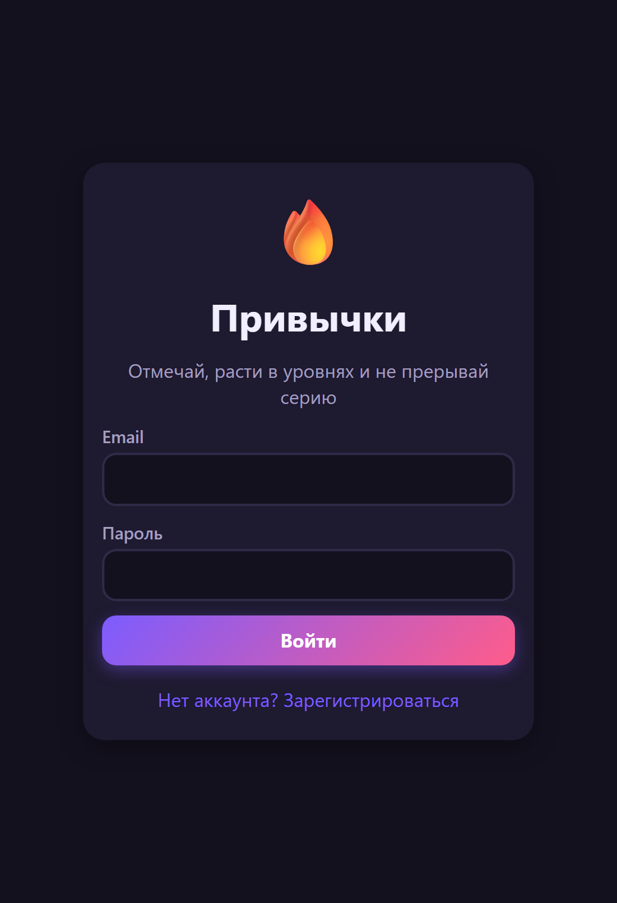
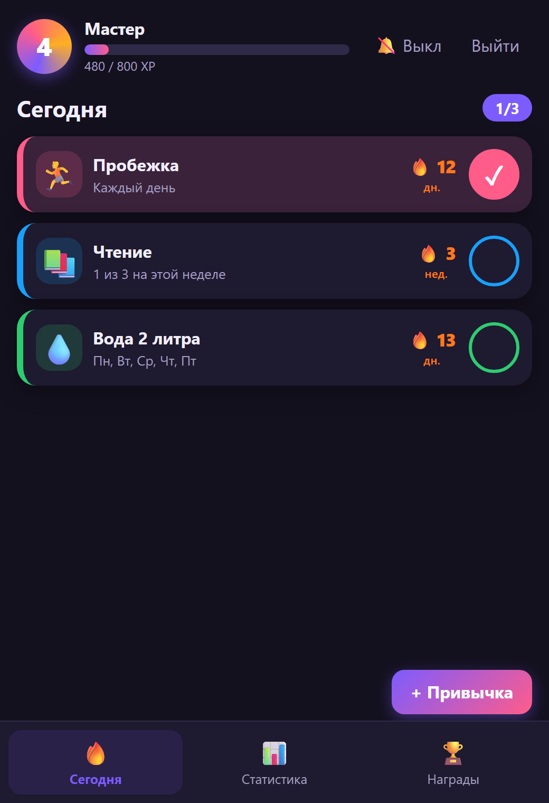
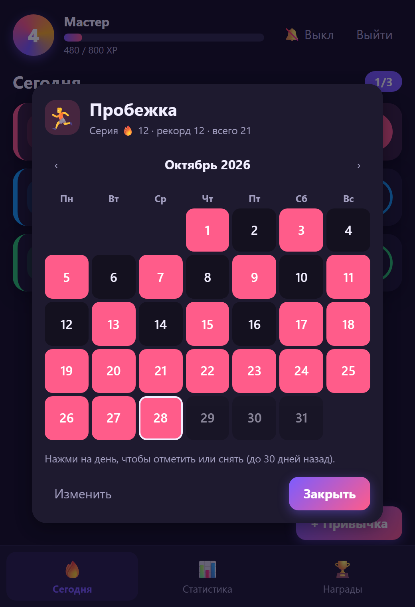
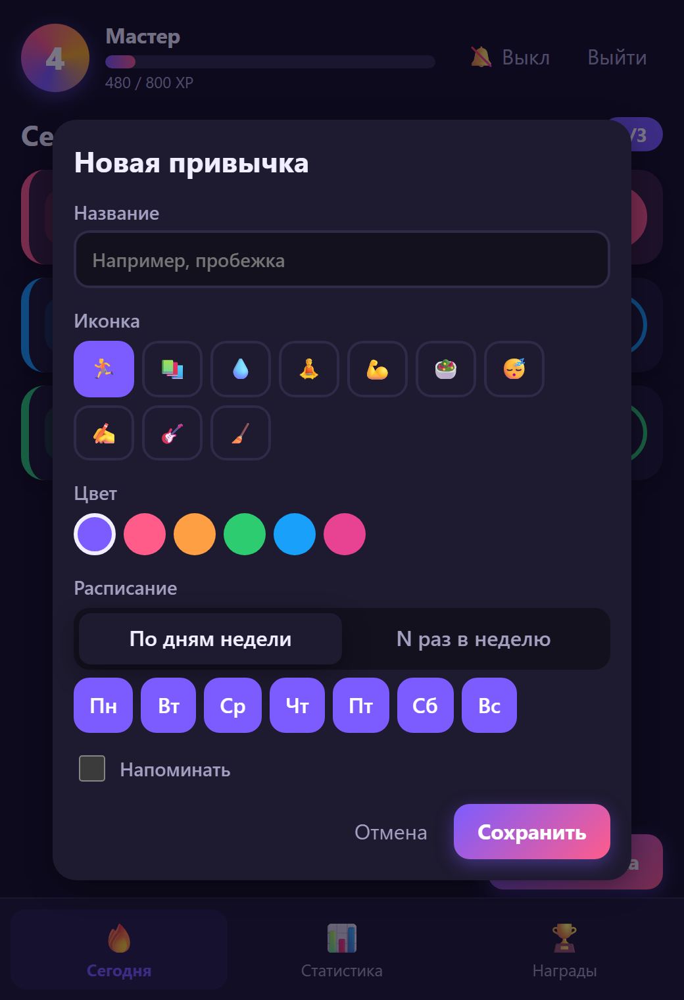
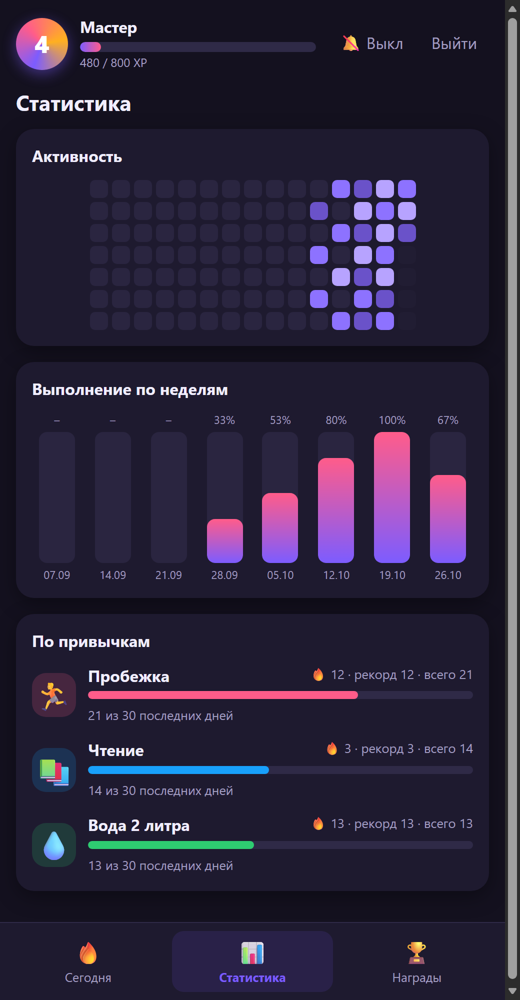
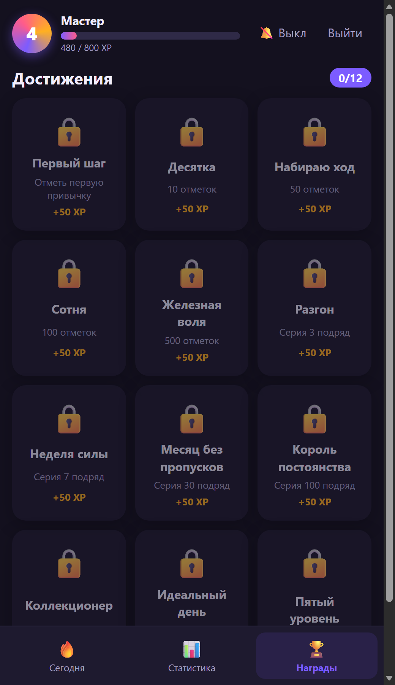

# 🔥 Привычки — трекер привычек с геймификацией

Веб-приложение для тех, кто хочет выработать полезные привычки и не бросать их через неделю. Пользователь заводит привычки с гибким расписанием, отмечает выполнение, держит серии (streak), зарабатывает XP, повышает уровень и открывает достижения. Статистика и напоминания в браузере помогают не терять темп.

## Команда

| Участник | Роли |
|---|---|
| Дария Тохтар ([GitHub](https://github.com/DariyaTokhtarBerikkyzy)) | Тимлид, аналитик, backend, frontend, тестировщик, DevOps (проект выполнен одним участником) |

Подробное распределение работы — в [docs/process.md](docs/process.md).

## Технологии

| Часть | Технологии |
|---|---|
| Клиент | React 19, TypeScript, Vite |
| Сервер | Node.js 24, Express 5, TypeScript (запуск через `tsx`) |
| СУБД | SQLite (встроенный в Node модуль `node:sqlite`) |
| Авторизация | bcryptjs (хеш паролей), JWT |
| Напоминания | Web Push (`web-push`, VAPID) и Service Worker |
| Тесты | встроенный `node:test` |
| Развёртывание | Docker, Docker Compose |

## Требования к окружению

Для запуска через Docker (рекомендуется):

- Docker 24 или новее с плагином Docker Compose v2;
- свободный порт 8080;
- современный браузер на Chromium (Chrome, Edge) или Firefox.

Для запуска без Docker (режим разработки): Node.js 22.5 или новее (проверено на 24) и npm 10+.

## Запуск

1. Установить Docker и Docker Compose.
2. Клонировать репозиторий:

   ```bash
   git clone https://github.com/DariyaTokhtarBerikkyzy/habit-tracker.git
   cd habit-tracker
   ```

3. Скопировать файл настроек:

   ```bash
   cp .env.example .env
   ```

   В Windows PowerShell: `Copy-Item .env.example .env`.

4. Запустить:

   ```bash
   docker compose up --build
   ```

5. Открыть http://localhost:8080

Данные хранятся в Docker-томе `habit-data` и сохраняются при перезапуске. Чтобы остановить приложение, нажми `Ctrl+C` (или `docker compose down`). Чтобы удалить и данные, выполни `docker compose down -v`.

### Тестовые учётные записи

Демо-пользователь создаётся при первом запуске (переменная `SEED_DEMO=true` в `.env`) и уже содержит три привычки с историей за 30 дней:

| Роль | Email | Пароль |
|---|---|---|
| Демо-пользователь | `demo@test.ru` | `demo123` |

Можно также зарегистрировать нового пользователя на экране входа (пароль не короче 6 символов).

### Запуск без Docker (разработка)

```bash
npm install
npm run dev
```

Клиент откроется на http://localhost:5173, API работает на http://localhost:3001. Чтобы в этом режиме появился демо-пользователь, запусти с `SEED_DEMO=true` (например, добавь строку в `server/.env`).

### Тесты

```bash
npm install
npm test
```

Подробности и ручные тест-кейсы — в [docs/testing.md](docs/testing.md).

## Настройки (`.env`)

| Переменная | Назначение |
|---|---|
| `PORT` | Порт API внутри контейнера (по умолчанию 3001) |
| `JWT_SECRET` | Секрет подписи токенов. Если пусто, генерируется при первом запуске и сохраняется в томе данных |
| `VAPID_SUBJECT` | Контакт для Web Push (`mailto:...` или `https://...`) |
| `SEED_DEMO` | `true` — создать демо-пользователя при старте |

Реальные значения в репозиторий не попадают: `.env` исключён через `.gitignore`, в репозитории лежит только `.env.example`.

## Возможности

- Регистрация и вход по email и паролю.
- Привычки по дням недели или «N раз в неделю», с цветом, иконкой и временем напоминания.
- Отметка выполнения одним нажатием, серии (streak) и рекорды.
- Календарь привычки: можно отметить или снять день за последние 30 дней.
- XP, уровни и 12 достижений.
- Статистика: тепловая карта активности, выполнение по неделям, прогресс по привычкам.
- Браузерные напоминания (Web Push).

## Скриншоты

| Вход | Сегодня | Календарь привычки |
|---|---|---|
|  |  |  |

| Новая привычка | Статистика | Достижения |
|---|---|---|
|  |  |  |

## Документация

| Файл | Содержание |
|---|---|
| [docs/tz.md](docs/tz.md) | Техническое задание: сценарии, требования, приёмка, ограничения |
| [docs/architecture.md](docs/architecture.md) | Архитектура, технологии, схема БД, API, структура проекта |
| [docs/testing.md](docs/testing.md) | Автотесты, команда запуска, ручные тест-кейсы |
| [docs/process.md](docs/process.md) | Распределение работы и процесс |
| [docs/ai.md](docs/ai.md) | Использование ИИ |
