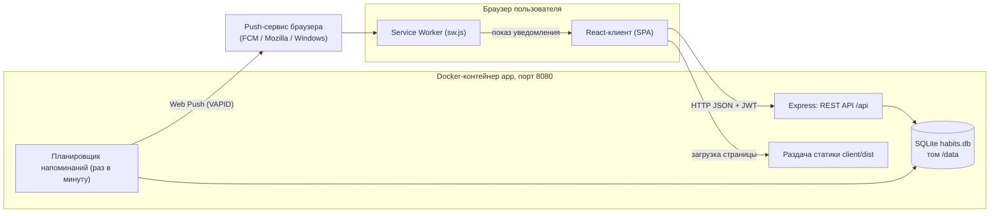
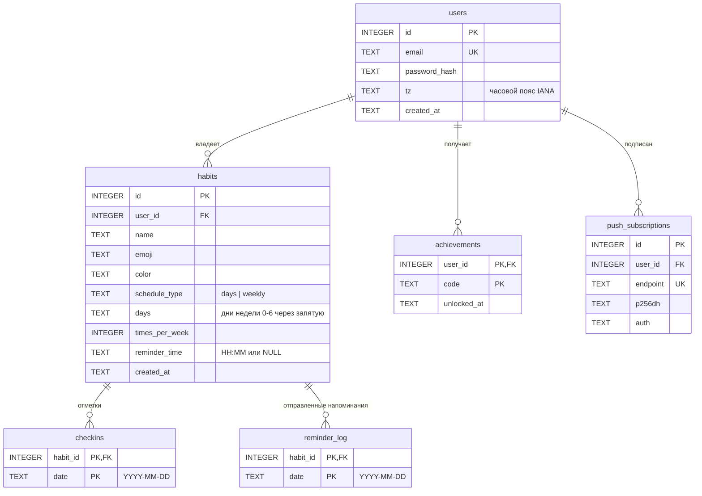

# Техническая документация

## 1. Архитектура

Система состоит из браузерного клиента, одного серверного процесса и файловой базы данных SQLite. Push-уведомления доставляются через сервис push-сообщений браузера (например, FCM у Chrome), к которому сервер обращается по протоколу Web Push.



**Взаимодействие.**

1. Браузер загружает статический клиент с того же сервера (в режиме разработки клиент работает на Vite, а запросы `/api` проксируются на сервер).
2. Клиент обращается к REST API, передавая JWT в заголовке `Authorization: Bearer …`. Клиент сам сообщает свою локальную дату («сегодня»), чтобы серии и расписание считались по времени пользователя.
3. Сервер хранит данные в SQLite. Серии, XP, уровни и достижения вычисляются на сервере из таблицы отметок; в базе хранятся только факты (отметки и открытые достижения).
4. Планировщик раз в минуту выбирает привычки с напоминанием, у пользователей которых есть подписки, и отправляет push по протоколу Web Push, подписывая запрос ключами VAPID.

## 2. Технологии и обоснование

| Технология | Обоснование |
|---|---|
| Node.js 24 + TypeScript | Один язык на клиенте и сервере, строгая типизация API-контрактов |
| Express 5 | Минимальный и привычный HTTP-фреймворк, достаточно для REST API из десятка маршрутов |
| SQLite (`node:sqlite`) | Данные связаны (пользователи, привычки, отметки) и нужны внешние ключи с каскадным удалением, но отдельный сервер СУБД для личного приложения избыточен; встроенный модуль не требует компиляции нативных библиотек |
| bcryptjs | Хеширование паролей с солью без нативных зависимостей (простая сборка в Docker и на Windows) |
| JWT (`jsonwebtoken`) | Сервер не хранит сессии, токен проверяется подписью |
| React 19 + Vite | Интерфейс из переиспользуемых компонентов с состоянием «привычки, пользователь»; Vite даёт быструю сборку и прокси для разработки |
| Web Push (`web-push`) + Service Worker | Единственный способ показывать уведомления в браузере, когда вкладка закрыта; без внешних платных сервисов |
| `node:test` | Встроенный тест-раннер, не добавляет зависимостей |
| Docker Compose | Запуск одной командой и сохранение данных в томе |

## 3. Схема базы данных



Все внешние ключи объявлены с `ON DELETE CASCADE`: удаление пользователя или привычки удаляет связанные записи. Схема создаётся при старте сервера (`server/src/db.ts`).

Дни недели: 0 — понедельник, …, 6 — воскресенье. XP и уровень в базе не хранятся: они вычисляются по формуле `XP = 10 × число отметок + 50 × число достижений`.

## 4. API

Базовый адрес: `/api`. Формат — JSON. Ошибки возвращаются как `{ "error": "сообщение" }` с кодом 4xx. Параметр `today` (дата пользователя `YYYY-MM-DD`) клиент передаёт в query-строке или теле запроса; если его нет, используется дата сервера в UTC.

| Метод | Адрес | Назначение | Доступ |
|---|---|---|---|
| POST | `/api/auth/register` | Регистрация. Тело: `{ "email", "password", "tz" }`. Возвращает `token` и `user` | Все |
| POST | `/api/auth/login` | Вход. Тело: `{ "email", "password", "tz" }`. Возвращает `token` и `user` | Все |
| GET | `/api/me` | Текущий пользователь: XP, уровень, звание | Авторизованный |
| GET | `/api/habits?today=…` | Список привычек со статусом на сегодня, серией и рекордом | Авторизованный |
| POST | `/api/habits` | Создать привычку. Тело: `{ "name", "emoji", "color", "scheduleType", "days", "timesPerWeek", "reminderTime" }` | Авторизованный |
| PUT | `/api/habits/:id` | Изменить привычку (те же поля) | Владелец |
| DELETE | `/api/habits/:id` | Удалить привычку вместе с отметками | Владелец |
| PUT | `/api/habits/:id/checkin` | Отметить или снять день. Тело: `{ "date": "YYYY-MM-DD", "done": true }`. Возвращает привычку, пользователя, `xpGained`, `newAchievements` | Владелец |
| GET | `/api/habits/:id/checkins?from=…&to=…` | Даты отметок за период | Владелец |
| GET | `/api/stats?today=…` | Данные статистики: `heatmap`, `weeks`, `perHabit` | Авторизованный |
| GET | `/api/achievements` | Список всех достижений с датой открытия | Авторизованный |
| GET | `/api/push/key` | Публичный ключ VAPID | Авторизованный |
| POST | `/api/push/subscribe` | Сохранить push-подписку. Тело: `{ "endpoint", "keys": { "p256dh", "auth" } }` | Авторизованный |
| POST | `/api/push/unsubscribe` | Удалить подписку. Тело: `{ "endpoint" }` | Авторизованный |
| POST | `/api/push/test` | Отправить тестовое уведомление на подписки пользователя | Авторизованный |

**Коды ошибок.** 400 — некорректные данные (сообщение в `error`); 401 — нет или неверен токен, либо неверный email/пароль; 404 — привычка не найдена или принадлежит другому пользователю, либо неизвестный маршрут; 409 — email уже зарегистрирован; 413 — тело запроса больше 100 КБ.

## 5. Структура проекта

```
habit-tracker/
├── client/                    # Клиент (React + TypeScript + Vite)
│   ├── public/                # Статика: sw.js (Service Worker), иконка
│   └── src/
│       ├── api.ts             # Типы и функции запросов к API, хранение токена
│       ├── push.ts            # Подписка на Web Push
│       ├── App.tsx            # Каркас: шапка с уровнем, вкладки, всплывающие награды
│       ├── components/        # Экраны и формы (вход, привычки, календарь, статистика, награды)
│       └── styles.css         # Стили, светлая и тёмная тема
├── server/                    # Сервер (Express + TypeScript)
│   └── src/
│       ├── index.ts           # Точка входа: запуск, демо-данные, планировщик
│       ├── app.ts             # Сборка Express-приложения, обработка ошибок, раздача клиента
│       ├── routes.ts          # REST API и проверка входных данных
│       ├── service.ts         # Привычки, статистика, пересчёт XP и достижений
│       ├── streak.ts          # Расчёт серий
│       ├── gamification.ts    # Формулы XP и уровней, список достижений
│       ├── push.ts            # Web Push и напоминания
│       ├── auth.ts            # Хеширование паролей, JWT, проверка токена
│       ├── db.ts              # Подключение и схема SQLite
│       ├── dates.ts           # Работа с датами YYYY-MM-DD
│       ├── seed.ts            # Демо-пользователь
│       ├── streak.test.ts     # Тесты серий
│       └── api.test.ts        # Тесты API
├── docs/                      # Документация и скриншоты
├── Dockerfile                 # Сборка клиента и запуск сервера
├── docker-compose.yml         # Сервис app, порт 8080, том данных
├── .env.example               # Шаблон настроек без значений
└── package.json               # npm workspaces: client, server
```
